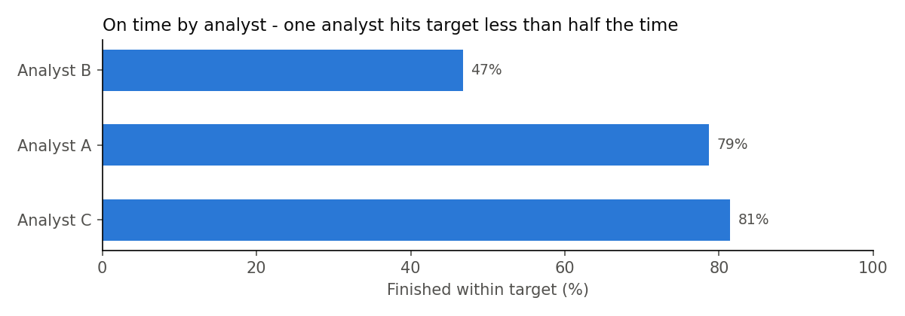

# Data Request Tracker

**Python (pandas, matplotlib) · SQL (SQLite + SQL Server version) · Excel**

On a reporting team, people send data requests all day - through email, Teams, in person. Things get lost, nobody knows who's working on what, and nobody can answer simple questions like *"how long do requests take?"*

This project is the analysis side of a request tracker: clean the request log, put it in a SQL database, and answer the questions a manager would ask. Everything here is **fake data I generated** - no real work data.

## Live dashboard

**[Open the dashboard](https://bunmii234.github.io/data-request-tracker/)** - one page with the results, charts, and a searchable list of open requests. No code or downloads needed. Start with the "pick a question" buttons at the top.

## Results at a glance





The full summary is `output/request_summary.xlsx` (GitHub can't preview Excel - click it, then **Download**). The clean data is [`output/requests_clean.csv`](output/requests_clean.csv) - GitHub shows it as a table.

## The data

`data/requests_raw.csv` - **305 rows**, one per request: who asked, what type, priority, who it's assigned to, status, and when it started and finished. The export was pulled on Sep 29, 2026, so anything not done by then is still open.

It's messy on purpose, like a real export:
- 5 duplicate rows
- team names typed different ways (`" finance "`, `"SALES"`) - 5 teams show up as 9 spellings
- 4 unfinished requests with no owner
- dates saved as text

## What I did - 6 steps

| Step | File | Tool | What it does |
|---|---|---|---|
| 0 | `python/00_generate_data.py` | Python | makes 300 fake requests + the mess |
| 1 | `python/01_clean_data.py` | pandas | removes duplicates, fixes team names, turns text into dates, marks blank owners as "Unassigned", calculates turnaround time |
| 2 | `python/02_load_to_sql.py` + `sql/` | SQL | loads the clean data into a database and runs 8 KPI queries |
| 3 | `python/03_summary_report.py` | pandas -> Excel | builds a 5-sheet Excel summary |
| 4 | `python/04_make_charts.py` | matplotlib | saves the charts as pictures for this page |
| 5 | `python/05_build_dashboard.py` + `dashboard/` | Python + HTML | builds the live team dashboard (`docs/index.html`) |

## The 8 questions (`sql/kpi_queries.sql`)

| # | Question | SQL used |
|---|---|---|
| Q1 | Which team sends the most work? | `GROUP BY` + `COUNT` |
| Q2 | Do High priority requests really get done faster? | `WHERE` + `AVG` |
| Q3 | How many missed their target? | `CASE WHEN` |
| Q4 | Who has the most open work right now? | `WHERE` + `GROUP BY` |
| Q5 | How does volume change by month? | date function |
| Q6 | What does each team ask for the most? | CTE (`WITH`) + `RANK()` |
| Q7 | Which analyst is on time most often? | CTE + `CASE WHEN` + `SUM` |
| Q8 | Which team's requests are on time most often? | CTE + `CASE WHEN` + `SUM` |

## What I found

- 305 raw rows -> **300 clean requests** (5 duplicates removed)
- **Average turnaround: 2.4 days** (median 2.0)
- Priority mostly works: High takes **0.9 days** on average, Medium **2.3**, Low **3.5**
- But **81 of 279 finished requests (29%) missed their target** - and **High priority missed the most often (20 of 55, 36%)**, so "urgent" isn't always fast enough
- **One analyst is on time 47% of the time vs. 79% and 82% for the other two** - that usually means too much work, worth a workload check
- By team, Sales requests are on time most (85%) and Business Development least (58%)
- **21 requests still open: 16 were never started** (the oldest waited 113 days) and 4 have no owner - those are the ones that get forgotten
- **Operations and Finance** send the most requests

## How the full tracker would work in Microsoft 365

The analysis above is the back end. For the front end (how requests come in) and the before/after numbers I'd track, see [`docs/m365_design.md`](docs/m365_design.md) - a Microsoft Form for requests, Power Automate to log them to a SharePoint list, and Power BI on top.

## Limitations

- **It's fake data.** I made Analyst B slower on purpose so the on-time check has something to find. Real data would be messier and the reasons would need to be investigated, not assumed.
- **Targets are my choice** (High 1 day, Medium 3, Low 5). A real team would set its own.
- **Turnaround counts calendar hours,** including nights and weekends. With real data I'd probably count business hours.
- **"Waiting" is measured to the export date.** A live tracker would update it every day.

## Run it yourself

Open a terminal in this folder, then:

```
pip install -r requirements.txt
python run_all.py
```

`run_all.py` runs all 6 steps in order. The summary shows up at `output/request_summary.xlsx` (5 sheets: **KPIs · By team · Monthly volume · On time by analyst · On time by team**) and the dashboard at `docs/index.html`.

**SQL Server:** the project runs on SQLite, but [`sql_server/kpi_queries_sqlserver.sql`](sql_server/kpi_queries_sqlserver.sql) shows the queries that need to be written differently for SQL Server (`FORMAT` instead of `strftime`, `TOP` instead of `LIMIT`).

## What I learned

- Clean first. `"finance "` and `"Finance"` look the same to a person, but to a computer they're 2 different teams - and every count comes out wrong.
- Most business questions in SQL follow the same pattern: filter -> group -> count/average -> sort.
- An average can hide a problem - High priority looked fast on average but missed its target most often.
- The Excel summary and dashboard matter as much as the analysis - that's the part people actually read.

Every code file has notes under each block explaining what that part does.
