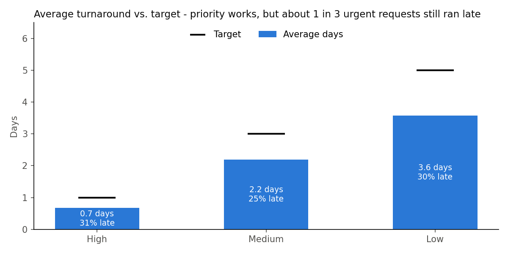
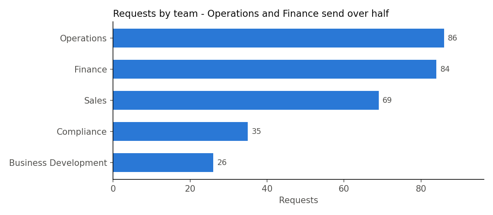

# Data Request Tracker

**Python (pandas) · SQL (SQLite) · Excel**

On a reporting team, people send data requests all day - through email, Teams, in person. Things get lost, nobody knows who's working on what, and nobody can answer simple questions like *"how long do requests take?"*

This project is the analysis side of a request tracker: clean the request log, put it in a SQL database, and answer the questions a manager would ask. Everything here is **fake data I generated** - no real work data.

## Live dashboard

**[Open the dashboard](https://bunmii234.github.io/data-request-tracker/)** - one page with the results, charts, and a searchable list. No code or downloads needed.

## Results at a glance





The full summary is `output/request_summary.xlsx` (GitHub can't preview Excel - click it, then **Download**). The clean data is [`output/requests_clean.csv`](output/requests_clean.csv) - GitHub shows it as a table.

## The data

`data/requests_raw.csv` - **305 rows**, one per request: who asked, what type, priority, who it's assigned to, status, and when it started and finished.

It's messy on purpose, like a real export:
- 5 duplicate rows
- team names typed different ways (`"finance "`, `"FINANCE"`, `"Finance"`)
- 4 requests with no owner
- dates saved as text

## What I did - 6 steps

| Step | File | Tool | What it does |
|---|---|---|---|
| 0 | `python/00_generate_data.py` | Python | makes 300 fake requests + the mess |
| 1 | `python/01_clean_data.py` | pandas | removes duplicates, fixes team names, turns text into dates, marks blank owners as "Unassigned", calculates turnaround time |
| 2 | `python/02_load_to_sql.py` + `sql/` | SQL | loads the clean data into a database and runs 6 KPI queries |
| 3 | `python/03_summary_report.py` | pandas -> Excel | builds a 3-sheet Excel summary: KPIs, by team, monthly volume |
| 4 | `python/04_make_charts.py` | matplotlib | saves the charts as pictures for this page |
| 5 | `python/05_build_dashboard.py` + `dashboard/` | Python + HTML | builds the live team dashboard page (`docs/index.html`) |

## The 6 questions (`sql/kpi_queries.sql`)

| # | Question | SQL used |
|---|---|---|
| Q1 | Which team sends the most work? | `GROUP BY` + `COUNT` |
| Q2 | Do High priority requests really get done faster? | `WHERE` + `AVG` |
| Q3 | How many missed their target? | `CASE WHEN` |
| Q4 | Who has the most open work right now? | `WHERE` + `GROUP BY` |
| Q5 | How does volume change by month? | date function |
| Q6 | What does each team ask for the most? | CTE (`WITH`) + `RANK()` |

## What I found

- 305 raw rows -> **300 clean requests** (5 duplicates removed, 4 with no owner flagged)
- **Average turnaround: 2.4 days** (median 2.1)
- Priority works: High takes **0.7 days** on average, Medium **2.2**, Low **3.6**
- But **63 of 228 finished requests (28%) missed their target** - and High priority missed the most often (13 of 42), so "urgent" isn't always fast enough
- **Operations and Finance** send the most requests
- **72 requests still open**, and 2 of them have no owner - those are the ones that get forgotten

## How the full tracker would work in Microsoft 365

The analysis above is the back end. For the front end (how requests come in), see [`docs/m365_design.md`](docs/m365_design.md) - a Microsoft Form for requests, Power Automate to log them to a SharePoint list, and Power BI on top.

## Run it yourself

Open a terminal in this folder, then:

```
pip install -r requirements.txt
python python/00_generate_data.py
python python/01_clean_data.py
python python/02_load_to_sql.py
python python/03_summary_report.py
python python/04_make_charts.py
python python/05_build_dashboard.py
```

## What I learned

- Clean first. `"finance "` and `"Finance"` look the same to a person, but to a computer they're 2 different teams - and every count comes out wrong.
- Most business questions in SQL follow the same pattern: filter -> group -> count/average -> sort.
- The Excel summary matters as much as the analysis - that's the part people actually read.

Every code file has notes under each block explaining what that part does.
